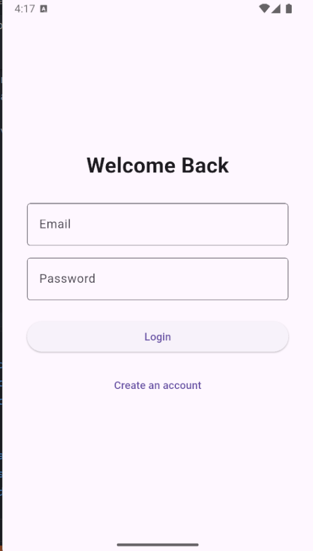
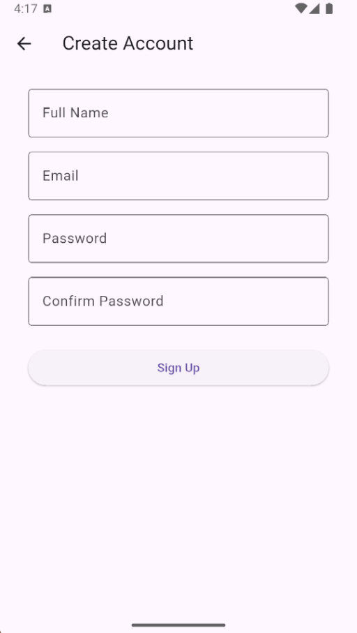
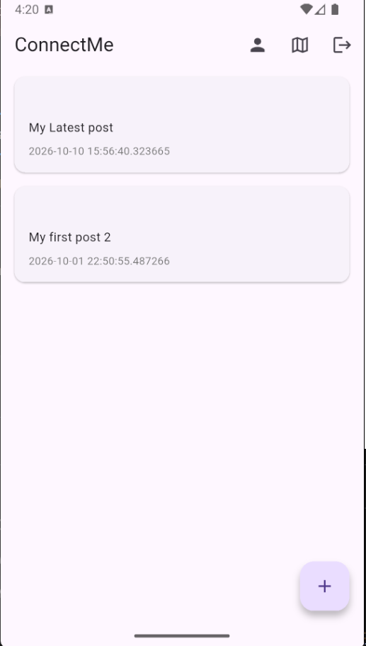
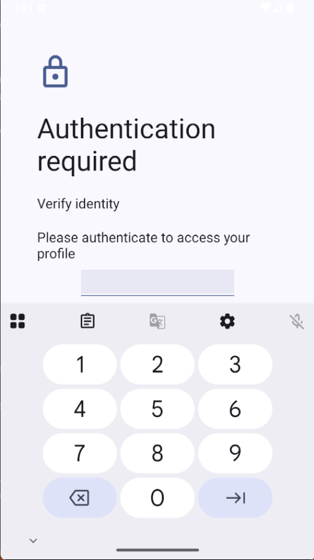
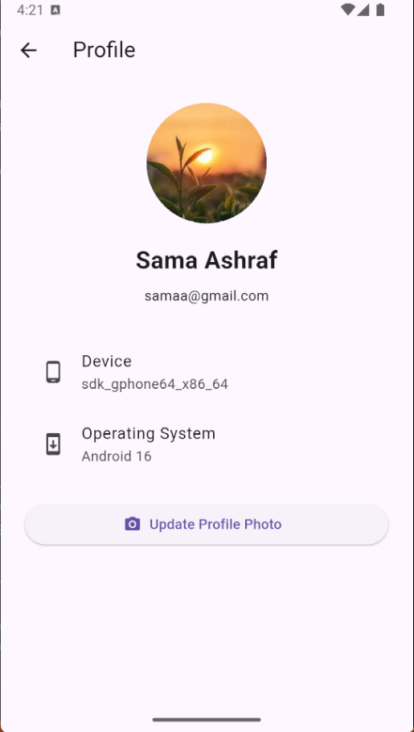
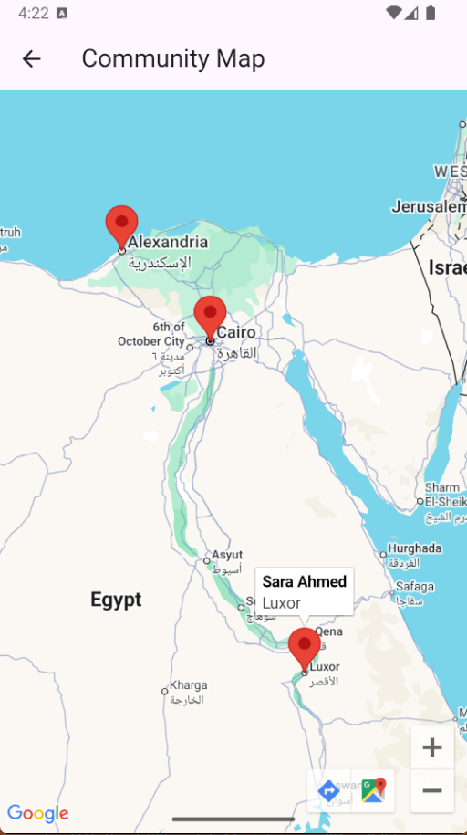
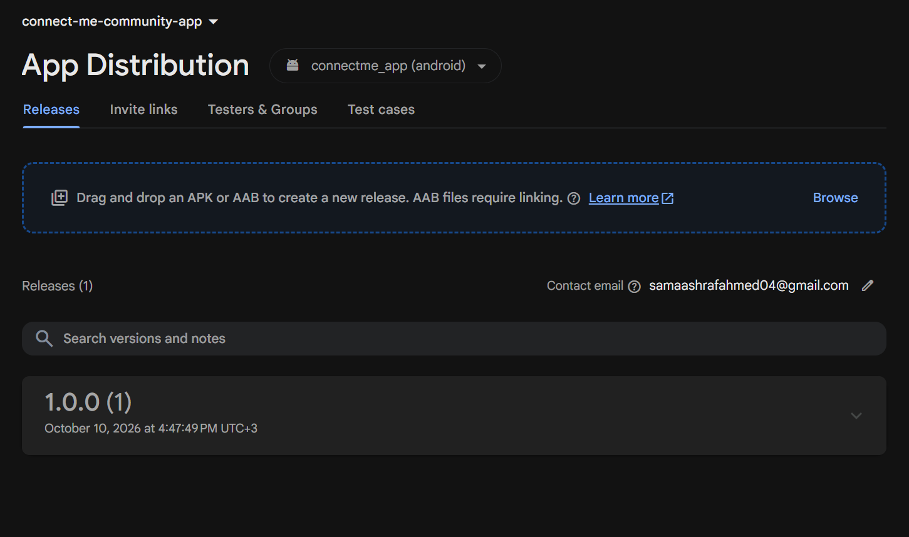
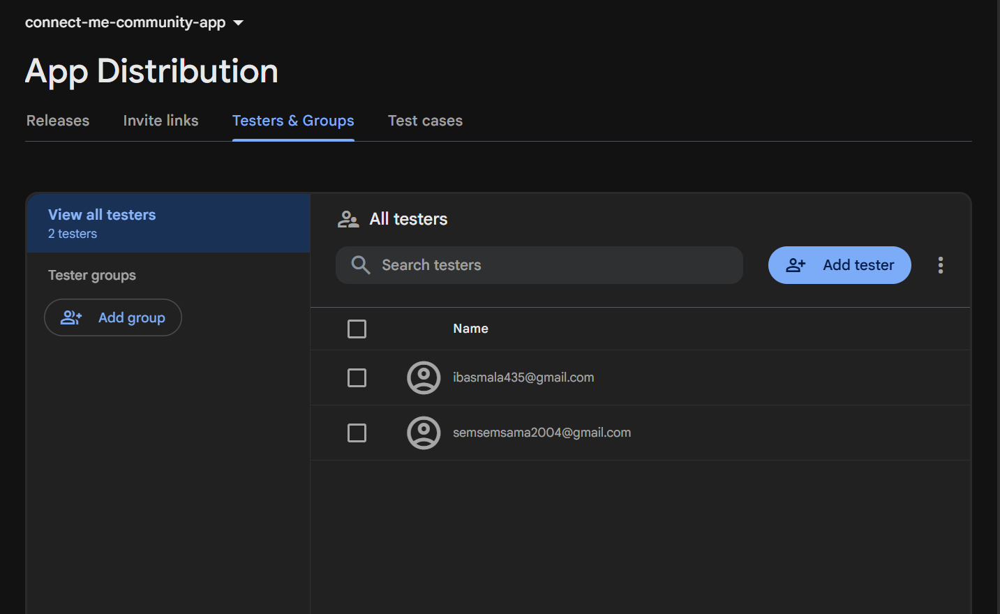

# ConnectMe Community App

ConnectMe is a production-oriented Flutter community app for sharing posts,
viewing community members on a map, and managing a device-aware profile.
Firebase Authentication and Cloud Firestore provide the backend, while
biometric authentication protects access to profile details.

## Features

- Email/password sign up and login with persisted Firebase Auth sessions.
- Sign-up validation for name, email, password, and password confirmation.
- Realtime Firestore community feed with post creation and friendly error states.
- Biometric gate before opening the profile.
- Gallery/camera profile image selection stored as compressed Base64 data in
  the user's Firestore document.
- Device model and operating system information via `device_info_plus`.
- Community map with member markers and info windows.
- Responsive layouts using `MediaQuery` and scrollable forms.

## Architecture

The project follows Clean Architecture:

```text
lib/
├── core/errors/                 Shared failure types
├── data/
│   ├── datasources/             Firestore and local post sources
│   ├── models/                  JSON models and User Builder
│   └── repositories/            Repository implementations
├── domain/
│   ├── entities/                Framework-independent business objects
│   ├── repositories/            Repository contracts
│   └── usecases/                Application actions
├── presentation/
│   ├── blocs/                   Auth, post, and profile Cubits
│   ├── screens/                 Feature screens
│   └── widgets/                 Reusable UI components
└── services/                    Firebase, biometric, and device services
```

Design patterns are applied deliberately:

- **Singleton:** `FirestoreService.instance` is registered once in GetIt.
- **Factory:** `PostDataSourceFactory` chooses the remote Firestore or local
  post source.
- **Builder:** `UserBuilder` only sets profile fields supplied by the caller.
- **Dependency injection:** all services, repositories, use cases, and Cubits
  are registered in `lib/injection.dart`.

## Setup

1. Install Flutter (Dart 3.13 or newer) and configure a Firebase project.
2. Run `flutterfire configure` to generate `lib/firebase_options.dart` and
   the native Firebase configuration files for your project.
3. Enable Email/Password Authentication and Cloud Firestore.
4. Add a Google Maps API key:

   ```bash
   flutter build apk --release \
     -- -PGOOGLE_MAPS_API_KEY=your-key
   ```

   Restrict the key to the Android package and Maps SDK for Android in Google
   Cloud Console. Configure the equivalent key in `ios/Runner/AppDelegate.swift`
   before an iOS build.

5. Install dependencies and validate the project:

   ```bash
   flutter pub get
   dart format lib
   flutter analyze
   flutter test
   ```

### Required permissions

- Android `USE_BIOMETRIC` for the biometric profile gate.
- Android camera/gallery access is requested by `image_picker` when needed.
- iOS `NSCameraUsageDescription` and `NSPhotoLibraryUsageDescription` should
  be added to `ios/Runner/Info.plist` when building for iOS.
- Google Maps requires the platform API key described above.

## Firebase App Distribution beta release

The APK must be uploaded from a trusted CI or release workstation; do not
commit service-account keys or API keys to Git.

1. Install and authenticate the Firebase CLI:

   ```bash
   npm install -g firebase-tools
   firebase login
   ```

2. Build a release APK using the production Firebase configuration:

   ```bash
   flutter pub get
   flutter build apk --release --build-number=1
   ```

3. Upload the artifact and invite at least two testers:

   ```bash
   firebase appdistribution:distribute \
     build/app/outputs/flutter-apk/app-release.apk \
     --app YOUR_ANDROID_FIREBASE_APP_ID \
     --testers tester-one@example.com,tester-two@example.com \
     --release-notes "ConnectMe v1.0 beta"
   ```

4. In Firebase Console → App Distribution, verify the release, both tester
   emails, and the invitation status. Each tester should accept the invitation,
   install the Firebase App Tester app, and install the release on a physical
   Android device.

## Screenshots

### Login



### Sign up



### Home feed



### Biometric profile gate



### Profile



### Community map



### App Distribution



### Testers Invitiations


